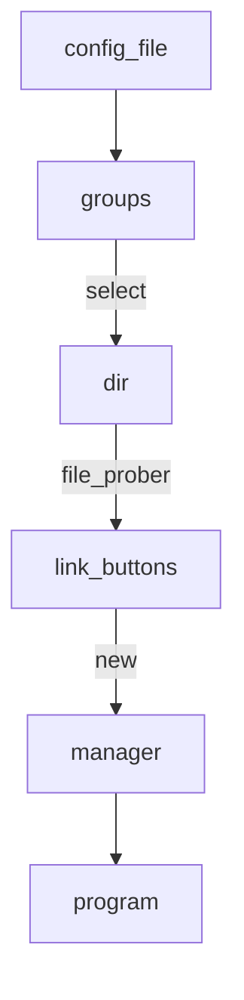

# Link Manager

This is a single tool that manage system soft links conveniently.



The configuration file will be a single map link this

```json
{
    "dir_map": {
            "~/utils/bin": "~/.local/bin",
        "~/utils/service": "~/.config/systemd/user"
    },
    "file_map": {
        "old_name": "new_name"
    }
}
```

## Steps

- Edit the configuraion file

- Start program

- User select the dir

- probe this dir then create new linkButtons

- construct new manager based on linkButtons

- User modify link status then `enter` for make real changes

As there is always some link share the source dir and dst dir, so manage them as group will be faster.

And this project is powered by [buttletea](https://github.com/charmbracelet/bubbletea)
