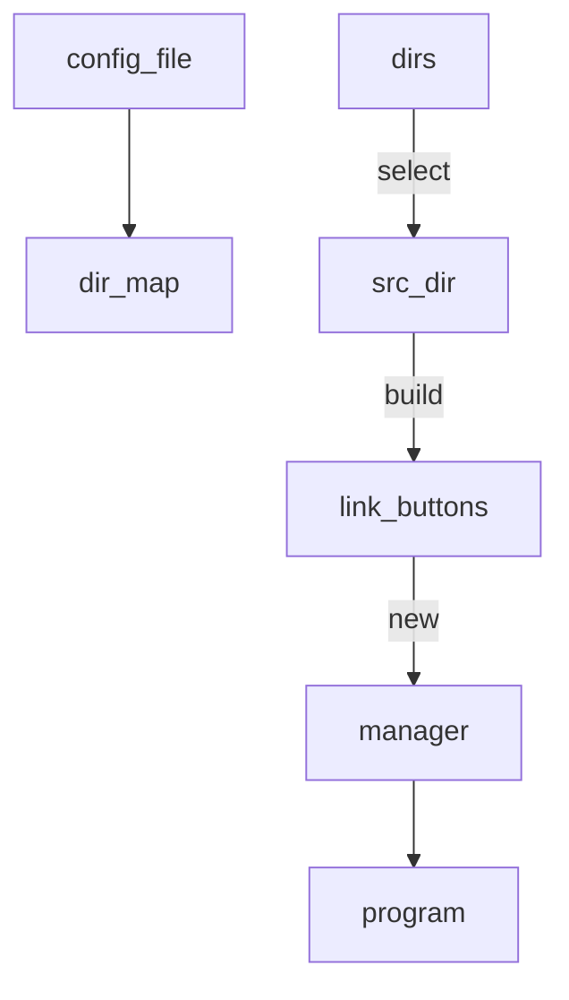

# Design

## Steps

- Edit the configuration file

- Start program

- select the dir

- probe this dir then create new linkButtons

- construct new manager based on linkButtons

- User modify link status then `enter` for make real changes

## Graph

